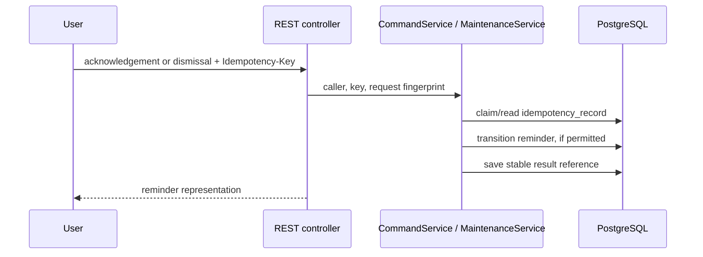

# Maintenance Reminder Service Architecture Analysis

> **Scope and evidence.** This is an implementation analysis made on 2026-09-27. It describes the code, Flyway migration, configuration, local mocks, and Kubernetes manifests in this repository. `../workflow` is the intended design reference; where it differs from the code, this document identifies the implementation rather than treating a planned feature as present.

## 1. Project overview and system boundary

Vehicle Maintenance Reminder (Maintenance Reminder Service) is a Spring Boot service for turning a vehicle's current maintenance state into durable maintenance reminders and notification requests. It is designed for an Connected Vehicle Platform-style platform.

Maintenance Reminder Service owns the current maintenance-state projection it needs for evaluation, maintenance-plan selection, reminder lifecycle, notification intent/history, idempotency records, and events awaiting publication. PostgreSQL is its system of record for those concerns.

Maintenance Reminder Service does **not** own raw telemetry (Telemetry), vehicle master data, message delivery (Notification Service), identity/authorization (vehicle access authorization service), or appointment availability/booking (appointment provider). It stores a minimal `vehicle_reference` projection to select plans, not a vehicle master.

The actual stack is Java 21, Spring Boot 3.5.16, Spring MVC, Spring Data JPA/Hibernate, Flyway, PostgreSQL, Spring Kafka, Spring Security OAuth2 resource-server support, Actuator/Micrometer Prometheus, Maven, JUnit 5, Testcontainers, Docker Compose, and Kubernetes manifests. Springdoc OpenAPI is on the classpath. The repository is a single deployable service, plus a local Kafka-capable mock Notification Service application.

## 2. Internal architecture

The source tree follows a lightweight hexagonal arrangement:

```text
Inbound adapters
  REST: ReminderController, ApiExceptionHandler
  Kafka: TelemetryMaintenanceStateListener, NotificationStatusListener
          |
          v
Application services
  MaintenanceService  CommandService  ReminderQueryService
  ports: TelemetryMaintenanceStateQueryPort, VehicleAccessPort, AppointmentAvailabilityPort
          |
          v
Domain utilities / states
  MaintenanceCycleReference, SourceOrdering, reminder/notification/outbox enums
          |
          v
Outbound adapters
  JPA repositories/entities -> PostgreSQL
  OutboxPublisher -> Kafka
  TelemetryRestAdapter, VehicleAccessAuthorizationAdapter, AppointmentAvailabilityAdapter -> HTTP
```

`domain` contains stateless business utilities and enums; the richer business orchestration currently lives in `MaintenanceService` in `application`. The JPA entity classes are persistence models in `adapter.outbound.persistence`, so application services directly depend on them. This preserves an adapter package boundary but is not a strict persistence-agnostic port-and-adapter implementation.

`MaintenanceReminderApplication` enables scheduled work. `SecurityConfig` permits every request unless `spring.security.oauth2.resourceserver.jwt.issuer-uri` is explicitly configured. With an issuer, health/info/Prometheus are public and all other endpoints require an authenticated JWT. The current controllers do not invoke `VehicleAccessPort`, so vehicle-level vehicle access authorization service authorization is not implemented.

## 3. Maintenance reminder lifecycle

### Event-driven path

```mermaid
sequenceDiagram
    participant Telemetry
    participant Kafka
    participant Maintenance Reminder Service as Maintenance Reminder Service Telemetry listener / MaintenanceService
    participant DB as PostgreSQL
    participant Publisher as OutboxPublisher
    participant Notification Service
    participant User

    Telemetry->>Kafka: telemetry.vehicle-maintenance-state.v1 (maintenance state)
    Kafka->>Maintenance Reminder Service: String JSON payload
    Maintenance Reminder Service->>DB: record processed event; compare source ordering
    Maintenance Reminder Service->>DB: upsert latest status and replace indicators
    Maintenance Reminder Service->>DB: select vehicle reference and active matching plan
    Maintenance Reminder Service->>DB: create reminder, notification, and outbox row atomically
    Publisher->>Kafka: cvp.notification-request.v1
    Kafka->>Notification Service: notification request
    Notification Service->>Kafka: cvp.notification-status.v1
    Kafka->>Maintenance Reminder Service: delivery outcome
    Maintenance Reminder Service->>DB: update notification status/timestamps
    Notification Service-->>User: delivery is owned by Notification Service (outside Maintenance Reminder Service)
```

`TelemetryMaintenanceStateListener` deserializes the Kafka value into `TelemetryMaintenanceStateEvent` and calls `MaintenanceService.ingest`.

1. The service validates only required event identity/vehicle/timestamp and non-negative odometer. It SHA-256 hashes Jackson's serialized event and uses `(Telemetry, eventId, maintenance-reminder-maintenance-state)` in `processed_event` as the inbox idempotency key.
2. If the event ID was already processed, it returns. For a new event, `SourceOrdering` compares source version where both versions exist; otherwise it compares source timestamps. Older state and same-content state are recorded as processed but do not change the projection. Same version/timestamp with a different checksum raises `ConflictException`.
3. An accepted event creates or updates one `vehicle_maintenance_status`, deletes that vehicle's indicators, and recreates indicators from `serviceIndicators`.
4. Evaluation only proceeds when a local `vehicle_reference` exists. For each indicator it finds active plans of the same maintenance type and selects the first plan whose optional model, market, powertrain, and model-year predicates match. No explicit plan ordering or conflict-resolution rule is implemented.
5. Telemetry due odometer/date values take precedence. Missing due values may be derived from plan distance (`current odometer + threshold`) or time (`today + threshold`). A SHA-256 `MaintenanceCycleReference` derived from vehicle, type, plan policy/scope, and due occurrence is the business-cycle identity.
6. If the unique vehicle/type/cycle reminder does not already exist, Maintenance Reminder Service creates it as `PENDING`, then immediately schedules it: state becomes `SCHEDULED`, one `IN_APP` `reminder_notification` is created as `PENDING`, and one `outbox_event` is created as `PENDING` in the same local transaction.
7. The scheduled publisher scans up to 50 eligible outbox records every configured second, sends the JSON payload to Kafka with notification ID as the key, then marks the event and notification `PUBLISHED`. The local mock Notification Service consumes this command and publishes a `DELIVERED` status, which Maintenance Reminder Service persists.

If the reference projection or matching plan is absent, the accepted maintenance state is retained but no reminder is created. The internal reevaluation endpoint repeats evaluation against stored status/indicators.

### User-command path



Acknowledgement changes a non-terminal reminder to `ACKNOWLEDGED`. Dismissal is forbidden for `CRITICAL` reminders and terminal (`DISMISSED`/`EXPIRED`) reminders. Repeating the same API idempotency key with the same internally constructed request string returns the previously recorded reminder ID; reusing it for a different request is a conflict.

## 4. Domain and persistence model

The code represents the following concepts with JPA entities, not separate rich domain aggregate classes.

| Concept | Responsibility and relationship | Lifecycle in the implementation |
| --- | --- | --- |
| `VehicleMaintenanceStatus` | One current Telemetry-derived state per vehicle; owns maintenance indicators via the `maintenance_indicator.vehicle_id` FK. | Created/updated for accepted Telemetry state; version/timestamp/checksum protect source ordering. |
| `MaintenanceIndicator` | One current service condition per vehicle and indicator code: due values, remaining values, severity, source timestamp. | All indicators for a vehicle are deleted and rebuilt after an accepted Telemetry event. |
| `MaintenancePlan` | Versioned policy row with applicability attributes, distance/time thresholds, severity policy, and validity range. | Read only by current code; plans must already be loaded by some external/admin process (none is implemented). |
| `Reminder` | Core maintenance reminder identified by UUID and business cycle. | Created `PENDING`, immediately changed to `SCHEDULED`; may be `ACKNOWLEDGED` or `DISMISSED`. `EXPIRED` is stored as an allowed enum but has no scheduler/transition implementation. |
| `ReminderNotification` | Notification occurrence owned by a reminder and independently tracked. | Created `PENDING`, set to `PUBLISHED` after Kafka acknowledgment, then updated from Notification Service status (`ACCEPTED`, `DELIVERED`, or `FAILED`). |
| `OutboxEvent` | Persisted notification request awaiting Kafka publication. | `PENDING` -> `IN_PROGRESS` -> `PUBLISHED`; failures currently return to `PENDING` with exponential delay, while the schema also permits `FAILED`. |
| `ProcessedEvent` | Kafka inbox/idempotency entry keyed by producer event and logical consumer. | Written for a first-seen Telemetry message, including stale/identical messages. No cleanup job exists. |
| `IdempotencyRecord` | REST command retry record keyed by caller and client key. | Created with response status 102, ends with 200 and a reminder result reference; expiry is one day. No cleanup job exists. |
| `VehicleReference` | Minimal attributes needed to choose a plan. | Read by evaluation; no inbound updater currently exists. |

`MaintenanceCycleReference` avoids duplicate reminders when the same maintenance cycle is observed again. `SourceOrdering` prevents a lower source version/timestamp from overwriting newer maintenance state. `@Version` is used on mutable status and reminder entities.

## 5. Database design

Flyway migration `V1__phase_1_core_schema.sql` is the sole schema migration. Hibernate runs with `ddl-auto=validate`.

| Table | Key relationships and purpose | Important integrity and access design |
| --- | --- | --- |
| `vehicle_reference` | PK `vehicle_id`; independent minimal reference projection. | Plan-selection index on market/model/year/powertrain; version/year checks. |
| `vehicle_maintenance_status` | PK `vehicle_id`; current maintenance projection. | Stores odometer, source timestamp/version, SHA-256 checksum, processing time, optimistic version. |
| `maintenance_indicator` | UUID PK; FK to status with `ON DELETE RESTRICT`. | Unique `(vehicle_id, indicator_code)` and vehicle/source-time index. |
| `maintenance_plan` | UUID PK; no FK to vehicle. | Natural unique policy identity; validity, model-year, threshold, and severity checks; lookup and scope/version indexes. |
| `reminder` | UUID PK; no physical FK to a vehicle master. | Unique `(vehicle_id, maintenance_type, maintenance_cycle_reference)` plus unique deduplication key; vehicle/status, scheduler, and due-date indexes. |
| `reminder_notification` | UUID PK; FK `reminder_id -> reminder.id`, restrict delete. | Unique idempotency and Notification Service request IDs; notification history/status indexes and status-timestamp consistency checks. |
| `processed_event` | Composite PK `(source_system, event_id, consumer_name)`. | Event checksum and cleanup-by-time index. |
| `idempotency_record` | Composite PK `(caller_id, idempotency_key)`. | Request hash, HTTP-style response status/result reference, expiry index. |
| `outbox_event` | UUID PK, polymorphic aggregate ID without FK. | JSONB object payload, publication/claim/retry fields; eligible publication, expired claim, and aggregate traceability indexes. |

The migration uses PostgreSQL `CHECK` constraints for nonblank identifiers, positive/non-negative values, legal enum strings, date validity, and selected lifecycle timestamp invariants. Reminder notification history is retained by `RESTRICT`; no deletion or retention process is implemented.

## 6. Kafka and event architecture

| Topic | Direction and implementation | Payload/key and outcome |
| --- | --- | --- |
| `telemetry.vehicle-maintenance-state.v1` | Telemetry -> Maintenance Reminder Service; `TelemetryMaintenanceStateListener` consumes it in consumer group `Maintenance Reminder Service` by default. | Raw String is parsed into fields `eventId`, `eventType`, `vehicleId`, occurrence/source time/version, odometer, and indicators. The producer should key by vehicle for ordering, but the listener does not inspect a record key. |
| `cvp.notification-request.v1` | Maintenance Reminder Service -> Notification Service; `OutboxPublisher` sends from `outbox_event`. | JSON object contains `eventId`, `notificationId`, `reminderId`, idempotency key, and vehicle ID. Kafka key is the notification UUID, even though the architectural design describes a reminder-oriented key. |
| `cvp.notification-status.v1` | Notification Service -> Maintenance Reminder Service; `NotificationStatusListener` consumes it. | JSON has notification ID, status, Notification Service request ID, occurred time. It updates a known notification; an unknown notification is ignored. |
| `cvp.appointment-status.v1` | Configured only. | There is no consumer or appointment lifecycle implementation. |

The outgoing event is a local compact command payload, not the full architecture document's common event envelope. No Maintenance Reminder Service reminder lifecycle topic is published by current code. The mock Notification Service is a separate Java application: it consumes notification requests, publishes `DELIVERED`, and commits its Kafka offset.

Telemetry duplicate protection is transactional in `MaintenanceService`. Notification Service status consumption currently has no `processed_event` deduplication or ordering guard; duplicate/reordered statuses may update the row again. Kafka auto-commit is disabled, and listener success determines normal Spring Kafka offset acknowledgment behavior. There are no configured retry topics, error handler, or DLQ.

## 7. REST API

All endpoints are in `ReminderController`; payloads use Java records and errors are Spring `ProblemDetail` responses.

| Method and path | Behavior |
| --- | --- |
| `GET /api/v1/vehicles/{vehicleId}/maintenance-reminders` | Lists reminders, optional `status`, `severity`, zero-based `page`, and `size`. Default page size is 20 when pagination is requested; maximum is 100. Sort is `updatedAt DESC, id ASC`. Response includes latest notification status. |
| `GET /api/v1/maintenance-reminders/{id}` | Returns one reminder or 404. |
| `GET /api/v1/vehicles/{vehicleId}/maintenance-status` | Returns stored vehicle ID, odometer, source timestamp, and source version, or 404. |
| `POST /api/v1/maintenance-reminders/{id}/acknowledgements` | Requires `Idempotency-Key`; acknowledges then returns the reminder. |
| `POST /api/v1/maintenance-reminders/{id}/dismissals` | Requires `Idempotency-Key`; rejects critical/terminal reminders, otherwise dismisses and returns it. |
| `POST /internal/v1/vehicles/{vehicleId}/maintenance-evaluations` | Requires `Idempotency-Key`; reevaluates current stored state and responds 202 with no body. |

`ApiExceptionHandler` maps `NotFoundException` to 404, `ConflictException` to 409, `IllegalArgumentException` and invalid enum/query conversion to 400. There is no explicit validation annotation, access check, 403 mapping, correlation ID propagation, cursor pagination, API-level response for an idempotent command in progress, or controller-level OpenAPI metadata.

## 8. External integrations

```text
Telemetry Kafka event -> inbound Kafka adapter -> MaintenanceService -> PostgreSQL projection/reminders
Maintenance Reminder Service reconciliation read -> TelemetryRestAdapter -> Telemetry GET /v1/vehicles/{vehicleId}/maintenance-state
Maintenance Reminder Service notification intent -> outbox -> OutboxPublisher -> Kafka -> Notification Service
Notification Service status Kafka event -> inbound Kafka adapter -> notification persistence
Maintenance Reminder Service access decision -> VehicleAccessAuthorizationAdapter -> vehicle access authorization service GET access endpoint (adapter exists; unused)
Maintenance Reminder Service appointment availability -> AppointmentAvailabilityAdapter -> appointment provider GET availability (adapter exists; unused)
```

Telemetry REST is represented by `TelemetryMaintenanceStateQueryPort` and `TelemetryRestAdapter`; no current application flow calls it. vehicle access authorization service and appointment provider similarly have ports/adapters but no call sites. Notification Service's configured HTTP base URL is not used by Maintenance Reminder Service; notification delivery is Kafka-based. Local Compose supplies WireMock Telemetry/vehicle access authorization service/appointment provider and a Kafka mock Notification Service. Notification Service's REST mapping file exists but is not part of the Maintenance Reminder Service runtime integration.

## 9. Reliability and operational behavior

The key reliability patterns already in code are local transactions around Telemetry ingestion, business-cycle uniqueness, source ordering, REST idempotency records, and the transactional outbox. The outbox separates database state from Kafka publication so a committed reminder/notification intent can be retried after a process failure instead of relying on a distributed transaction.

The scheduled outbox publisher selects `PENDING` or `FAILED` records with `next_attempt_at <= now`, marks a record `IN_PROGRESS`, then waits for `KafkaTemplate.send(...).get()`. On exception it increments attempts and schedules capped exponential backoff (up to 60 seconds); at five or more attempts the code sets the status to `FAILED`. However, because the query includes `FAILED`, it will still scan it when eligible, so `FAILED` is not terminal in the implementation. The schema has lease fields, but the repository query does not use row locking, claim tokens, or expired-claim recovery; multiple service replicas can race to publish the same event. Also, `publish()` invokes the same bean's `@Transactional publishOne()` directly, so normal Spring proxy transaction interception does not apply to that self-invocation. These are implementation characteristics, not claims of the intended design.

No remote HTTP call is made in the Telemetry ingestion transaction. Conversely, the publisher's Kafka send occurs in its local persistence method rather than as a separately coordinated post-commit workflow. The application has no HTTP client timeouts/retries/circuit breakers, no Kafka retry/DLQ policy, no cleanup scheduler for idempotency/inbox/outbox data, and no explicit metrics beyond exposed Spring/Micrometer endpoints.

## 10. Deployment architecture

The Dockerfile builds with Eclipse Temurin 21 JDK, runs Maven package with tests skipped, and emits a Temurin 21 JRE image exposing port 8080. Docker Compose runs PostgreSQL 16, single-node Kafka 3.9.0 in KRaft combined broker/controller mode, WireMock Telemetry/vehicle access authorization service/appointment provider, mock Notification Service, and Maintenance Reminder Service. Maintenance Reminder Service receives connection endpoints through environment variables. Compose maps Maintenance Reminder Service 8080, PostgreSQL 5432, Kafka 9092, Telemetry 8081, vehicle access authorization service 8083, and appointment provider 8084 to the host.

Kubernetes manifests create namespace `cvp`, a secret/config map, a single-replica PostgreSQL StatefulSet with a 1 Gi PVC, a single-replica Kafka Deployment, mock deployments, and a single-replica Maintenance Reminder Service Deployment plus ClusterIP Services. The Maintenance Reminder Service pod has startup/readiness/liveness probes against Actuator health and resource requests/limits. The manifests describe a deployable development-style topology; they do not include ingress, horizontal scaling, network policies, TLS, Kafka ACLs, external managed dependencies, or a real identity provider.

```text
Docker image (cvp-maintenance-reminder-service:1.0)
  -> Kubernetes Deployment/Maintenance Reminder Service (1 replica)
     -> Pod/Maintenance Reminder Service
        -> container: Maintenance Reminder Service Java process on 8080
           -> ClusterIP Service/Maintenance Reminder Service

The same namespace hosts PostgreSQL, Kafka, and mock Telemetry/Notification Service/vehicle access authorization service/appointment provider pods.
```

## 11. Implemented-versus-planned boundary

The source design contains future or intended capabilities that should not be assumed to be operational in this repository:

- No vehicle-reference ingestion/refresh, maintenance-plan administration, maintenance-history integration, preferences, escalation, expiry scheduler, or appointment session/booking flow.
- No appointment provider appointment-status consumer, no reminder `BOOKED` state, and no appointment tables.
- No customer recipient resolution; notifications are always `IN_APP` and have no recipient reference.
- No Maintenance Reminder Service reminder lifecycle event topic, schema governance, correlation ID propagation, or full common event envelope.
- No controller use of vehicle access authorization service access adapter or JWT scope/claim authorization policy beyond optional authentication.
- No production-grade retry/DLQ, multi-publisher claim locking, retention jobs, or external-call resilience controls.

## 12. Overall component relationship diagram

```mermaid
flowchart LR
    Telemetry[Telemetry] -->|maintenance-state topic| K[(Kafka)]
    K -->|Telemetry event| Maintenance Reminder Service[Maintenance Reminder Service Spring Boot service]
    Maintenance Reminder Service -->|projection, reminders, inbox, outbox| DB[(PostgreSQL)]
    Maintenance Reminder Service -->|notification request topic| K
    K --> Notification Service[Notification Service / local mock]
    Notification Service -->|notification status topic| K
    Maintenance Reminder Service -. on-demand query adapter .-> Telemetry
    Maintenance Reminder Service -. access adapter, currently unused .-> AUTHORIZATION[vehicle access authorization service]
    Maintenance Reminder Service -. availability adapter, currently unused .-> APPOINTMENT_PROVIDER[appointment provider]
    User[User/client] -->|REST| Maintenance Reminder Service
```

## Final summary

Maintenance Reminder Service currently implements the core Phase 1 path from a Telemetry maintenance-state Kafka event to a deduplicated reminder, durable notification intent, Kafka notification request, and persisted Notification Service delivery outcome. Its durable projections and constraints make the current behavior understandable and testable, while the adapter ports keep future Telemetry/vehicle access authorization service/appointment provider integrations recognizable.

For future development, treat the migration and source code as the authoritative statement of what executes today, and treat the architecture design documents as the approved target and decision record. The most important gap to keep explicit is that several reliability, authorization, scheduler, and integration capabilities are designed but not yet implemented.
